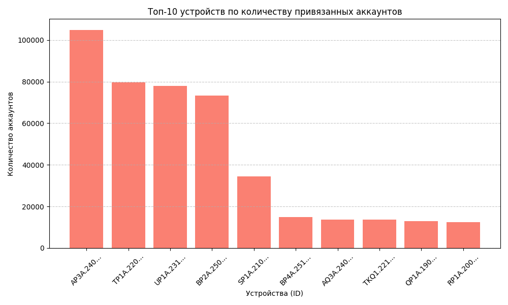
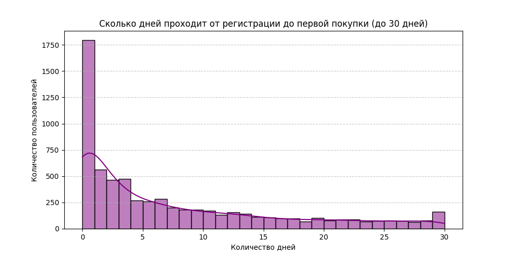

# Анализ продуктовых гипотез интернет-сервиса (VPN)

# Краткое резюме
В рамках исследования были проанализированы данные интернет-сервиса (мобильное приложение для Android/iOS). Цель-выявить паттерны поведения пользователей и найти точки роста конверсии в платную подписку. В ходе работы проверены 4 гипотезы: от борьбы с мультиаккаунтами до анализа технических сбоев. 

*Ключевые выводы:*
*   76.4% пользователей покупают подписку после использования триала.
*   Медианное время от регистрации до покупки составляет 15 дней (пик покупок приходится на 0-й и 14-15-й дни).
*   Главная техническая проблема, мешающая подписк- отказ DNS (*Failed host lookup*), зафиксировано более 300 тыс. ошибок в логах (на выборке из 200 пользователей).


# Описание данных
Для анализа использовались выгрузки из БД (PostgreSQL) и логи клиентских приложений.
*   *users.csv*-данные о пользователях (1 844 880 записей).
*   *devices.csv*-данные об устройствах (2 381 480 записей).
*   *subscribe.csv*-данные о подписках (29 046 платящих пользователей).
*   *logs.zip*-архив логов Android-приложения (формат Logcat).


# Проверка гипотез

# Гипотеза 1: Использование мультиаккаунтов для триала
*Суть:* Часть пользователей создает новые аккаунты для повторного использования триала.
*Как проверяли:* Группировали *device_identifier* и считали уникальных *user_id*.
*Результат:* Найдено 8 888 устройств с более чем 1 аккаунтом. На этих устройствах зарегистрировано 621 375 пользователей. 

**Вывод:** Анализ показал, что поле *device_identifier* содержит модель устройства, а не серийный номер. Для точного поиска мультиаккаунтов необходимо использовать *appmetrica_device_id*. 

# Гипотеза 2: Эффективность триал-периода
*Суть:* Большинство пользователей покупают подписку только после использования бесплатного триала.
*Как проверяли:* Сравнили наличие *trial_used_at* у пользователей с активной подпиской.
*Результат:* Из 29 046 платящих пользователей *22 193 (76.4%)* сначала использовали триал, и только *6 853* купили сразу без триала.
**Вывод:** Гипотеза подтверждена. Триал -критически важный этап воронки. 

# Гипотеза 3: Скорость принятия решения о покупке
*Суть:* Пользователям нужно время (более 14 дней), чтобы распробовать сервис и купить его.
*Как проверяли:* Считали разницу в днях между *created_at* (регистрация) и *created_at* (первая подписка).
*Результат:* Медианное время до покупки — *15 дней*. Среднее — *46.8 дней*. 

**Вывод:** Гипотеза подтверждена. Пик покупок приходится на день регистрации и на 14-15 день. Рекомендуется отправлять пуш-уведомления за 2 дня до конца триала.

# Гипотеза 4: Ошибки в логах как причина оттока
*Суть:* Типовые ошибки приводят к тому, что пользователи не могут подключиться и уходят.
*Как проверяли:* Проанализировали *logs.zip* (выборка 200 пользователей), отфильтровали логи по ключевым словам *failed*, *error*, *exception*.
*Результат:* Самая частая критическая ошибка- *Failed host lookup: 'api.pipster.win'* (более 300 тыс. раз на выборке из 200 юзеров). 
**Вывод:** Гипотеза подтверждена. Проблема с DNS блокирует работу приложения.


# Рекомендации для бизнеса
1.  *Уведомления:* Внедрить триггерные пуш-уведомления за 48 часов до окончания триала.
2.  *Техническая стабильность:* Внедрить резервные DNS-серверы в клиентское приложение, чтобы обойти блокировки провайдеров и снизить количество ошибок *Failed host lookup*.
3.  *Аналитика:* Срочно внедрить передачу уникального *appmetrica_device_id* для выявления ферм и мультиаккаунтов.


# Анализ продуктовых гипотез интернет-сервиса (VPN)

# Краткое резюме
В рамках исследования были проанализированы данные интернет-сервиса (мобильное приложение для Android/iOS). Цель-выявить паттерны поведения пользователей и найти точки роста конверсии в платную подписку. В ходе работы проверены 4 гипотезы: от борьбы с мультиаккаунтами до анализа технических сбоев. 

*Ключевые выводы:*
*   76.4% пользователей покупают подписку после использования триала.
*   Медианное время от регистрации до покупки составляет 15 дней (пик покупок приходится на 0-й и 14-15-й дни).
*   Главная техническая проблема, мешающая подписк- отказ DNS (*Failed host lookup*), зафиксировано более 300 тыс. ошибок в логах (на выборке из 200 пользователей).


# Описание данных
Для анализа использовались выгрузки из БД (PostgreSQL) и логи клиентских приложений.
*   *users.csv*-данные о пользователях (1 844 880 записей).
*   *devices.csv*-данные об устройствах (2 381 480 записей).
*   *subscribe.csv*-данные о подписках (29 046 платящих пользователей).
*   *logs.zip*-архив логов Android-приложения (формат Logcat).


# Проверка гипотез

# Гипотеза 1: Использование мультиаккаунтов для триала
*Суть:* Часть пользователей создает новые аккаунты для повторного использования триала.
*Как проверяли:* Группировали *device_identifier* и считали уникальных *user_id*.
*Результат:* Найдено 8 888 устройств с более чем 1 аккаунтом. На этих устройствах зарегистрировано 621 375 пользователей. 

**Вывод:** Анализ показал, что поле *device_identifier* содержит модель устройства, а не серийный номер. Для точного поиска мультиаккаунтов необходимо использовать *appmetrica_device_id*. 

# Гипотеза 2: Эффективность триал-периода
*Суть:* Большинство пользователей покупают подписку только после использования бесплатного триала.
*Как проверяли:* Сравнили наличие *trial_used_at* у пользователей с активной подпиской.
*Результат:* Из 29 046 платящих пользователей *22 193 (76.4%)* сначала использовали триал, и только *6 853* купили сразу без триала.
**Вывод:** Гипотеза подтверждена. Триал -критически важный этап воронки. 

# Гипотеза 3: Скорость принятия решения о покупке
*Суть:* Пользователям нужно время (более 14 дней), чтобы распробовать сервис и купить его.
*Как проверяли:* Считали разницу в днях между *created_at* (регистрация) и *created_at* (первая подписка).
*Результат:* Медианное время до покупки — *15 дней*. Среднее — *46.8 дней*. 

**Вывод:** Гипотеза подтверждена. Пик покупок приходится на день регистрации и на 14-15 день. Рекомендуется отправлять пуш-уведомления за 2 дня до конца триала.

# Гипотеза 4: Ошибки в логах как причина оттока
*Суть:* Типовые ошибки приводят к тому, что пользователи не могут подключиться и уходят.
*Как проверяли:* Проанализировали *logs.zip* (выборка 200 пользователей), отфильтровали логи по ключевым словам *failed*, *error*, *exception*.
*Результат:* Самая частая критическая ошибка- *Failed host lookup: 'api.pipster.win'* (более 300 тыс. раз на выборке из 200 юзеров). 
**Вывод:** Гипотеза подтверждена. Проблема с DNS блокирует работу приложения.


# Рекомендации для бизнеса
1.  *Уведомления:* Внедрить триггерные пуш-уведомления за 48 часов до окончания триала.
2.  *Техническая стабильность:* Внедрить резервные DNS-серверы в клиентское приложение, чтобы обойти блокировки провайдеров и снизить количество ошибок *Failed host lookup*.
3.  *Аналитика:* Срочно внедрить передачу уникального *appmetrica_device_id* для выявления ферм и мультиаккаунтов.

---

# Исходный код анализа (Python / Pandas)

<details>
<summary> Нажмите здесь, чтобы развернуть код проверки гипотез</summary>
    
```
# 1. Поиск мультиаккаунтов

import pandas as pd
import matplotlib.pyplot as plt

users = pd.read_csv('/content/drive/MyDrive/data_project/users.csv', sep=';', header=None, usecols=[0, 9], names=['user_id', 'trial_used_at'])
devices = pd.read_csv('/content/drive/MyDrive/data_project/devices.csv', sep=';', header=None, usecols=[1, 2], names=['user_id', 'device_identifier'])

device_users_count = devices.groupby('device_identifier')['user_id'].nunique().reset_index()
device_users_count.rename(columns={'user_id': 'accounts_count'}, inplace=True)
multi_account_devices = device_users_count[device_users_count['accounts_count'] > 1].copy()

merged_data = pd.merge(devices, users, on='user_id', how='inner')
multi_acc_users = merged_data[merged_data['device_identifier'].isin(multi_account_devices['device_identifier'])]
multi_acc_users_trial = multi_acc_users[multi_acc_users['trial_used_at'].notna()]

print(f"Найдено устройств с более чем 1 аккаунтом: {len(multi_account_devices)}")
print(f"Всего пользователей на устройствах с мультиаккаунтами: {multi_acc_users['user_id'].nunique()}")
print(f"Из них использовали триал: {multi_acc_users_trial['user_id'].nunique()}")

top_devices = multi_account_devices.sort_values(by='accounts_count', ascending=False).head(10)
plt.figure(figsize=(10, 6))
plt.bar(range(len(top_devices)), top_devices['accounts_count'], color='salmon')
plt.title('Топ-10 устройств по количеству привязанных аккаунтов')
plt.show()

#2. Анализ триала и времени до покупки\

import pandas as pd
import matplotlib.pyplot as plt
import seaborn as sns

users = pd.read_csv('/content/drive/MyDrive/data_project/users.csv', sep=';', header=None, usecols=[0, 5, 9], names=['user_id', 'registered_at', 'trial_used_at'])
subs = pd.read_csv('/content/drive/MyDrive/data_project/subscribe.csv', sep=';', header=None, usecols=[1, 4], names=['user_id', 'subscribed_at'])

subs = subs.sort_values('subscribed_at').drop_duplicates(subset=['user_id'], keep='first')
df = pd.merge(users, subs, on='user_id', how='left')

df['has_subscription'] = df['subscribed_at'].notna()
df['used_trial'] = df['trial_used_at'].notna()

total_buyers = df['has_subscription'].sum()
buyers_with_trial = df[(df['has_subscription'] == True) & (df['used_trial'] == True)]
buyers_without_trial = df[(df['has_subscription'] == True) & (df['used_trial'] == False)]

print(f"Всего пользователей с платной подпиской: {total_buyers}")
print(f"Сначала использовали триал: {len(buyers_with_trial)}")
print(f"Купили сразу без триала: {len(buyers_without_trial)}")

df_buyers = df[df['has_subscription'] == True].copy()
df_buyers['registered_at'] = pd.to_datetime(df_buyers['registered_at'], errors='coerce')
df_buyers['subscribed_at'] = pd.to_datetime(df_buyers['subscribed_at'], errors='coerce')
df_buyers = df_buyers.dropna(subset=['registered_at', 'subscribed_at'])

df_buyers['days_to_buy'] = (df_buyers['subscribed_at'] - df_buyers['registered_at']).dt.days
df_buyers = df_buyers[df_buyers['days_to_buy'] >= 0]

print(f"Медианное время до покупки: {df_buyers['days_to_buy'].median():.1f} дней")

plt.figure(figsize=(10, 5))
plot_data = df_buyers[df_buyers['days_to_buy'] <= 30]['days_to_buy']
sns.histplot(plot_data, bins=30, kde=True, color='purple')
plt.title('Сколько дней проходит от регистрации до первой покупки')
plt.show()

#3. Парсинг логов и поиск ошибок
import zipfile
import io
import re
from collections import Counter

zip_path = '/content/drive/MyDrive/data_project/logs.zip'
real_errors = []
keywords = ['failed', 'error', 'exception', 'timeout', 'refused', 'unreachable']

with zipfile.ZipFile(zip_path, 'r') as z:
    inner_zips = [f for f in z.namelist() if f.endswith('.zip')]
    sample_zips = inner_zips[:200]
    
    for inner_zip_path in sample_zips:
        try:
            inner_zip_bytes = z.read(inner_zip_path)
            inner_zip = zipfile.ZipFile(io.BytesIO(inner_zip_bytes))
            
            for log_file in inner_zip.namelist():
                if log_file.endswith('.log') or log_file == 'vpn_error_log.txt':
                    with inner_zip.open(log_file) as f:
                        content = f.read().decode('utf-8', errors='ignore')
                        for line in content.split('\n'):
                            if any(kw in line.lower() for kw in keywords):
                                real_errors.append(line.strip())
        except Exception:
            pass

cleaned_errors = []
for err in real_errors:
    cleaned = re.sub(r'\b\d{1,3}\.\d{1,3}\.\d{1,3}\.\d{1,3}(:\d+)?\b', 'IP', err)
    cleaned = re.sub(r'\d+', 'X', cleaned)
    cleaned_errors.append(cleaned)

top_errors = Counter(cleaned_errors).most_common(10)
for err, count in top_errors:
    print(f"[{count} раз] {err[:250]}")


</details> ```


